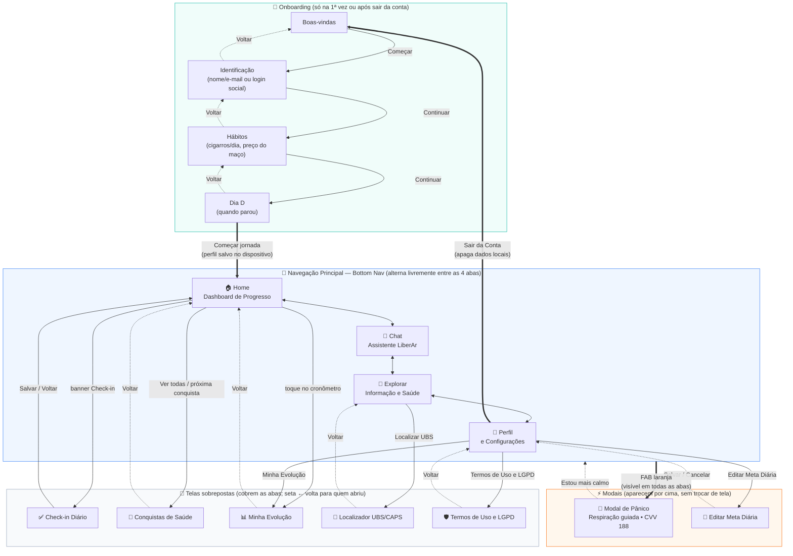

# LiberAr — Fluxo de Navegação

Como as telas se relacionam: o que abre o quê, e para onde cada tela volta.

## Regras de navegação

| Situação | Comportamento |
|---|---|
| Primeira abertura (sem perfil salvo) | O app entra direto no **Onboarding**; as abas só aparecem depois do "Começar jornada". |
| Aberturas seguintes | O perfil vem do armazenamento local e o app abre direto na **Home**. |
| Abas (Home, Chat, Explorar, Perfil) | Alternam livremente pela bottom nav; nenhuma "volta" — são pares. |
| Telas sobrepostas | Abertas por botões dentro das abas; a seta **←** retorna sempre à tela que as abriu. A bottom nav fica oculta enquanto elas estão abertas. |
| Botão de Emergência (FAB) | Disponível em **qualquer aba**; abre o modal de pânico por cima de tudo, sem perder onde o usuário estava. |
| Sair da Conta | Apaga perfil e check-ins (LGPD — direito ao esquecimento) e devolve ao início do Onboarding. |

## Origem de cada tela

| Tela | Origem |
|---|---|
| Home, Chat, Check-in, Explorar, Perfil, Modal de Pânico | **Protótipo do Figma** (mantidas fielmente, apenas conectadas aos dados reais) |
| Onboarding (4 etapas), Conquistas, Evolução, Localizador UBS/CAPS, Termos/LGPD, modal Meta Diária | **Adicionadas** a partir do diagrama de arquitetura (fluxos 1, 4 e 5) |
