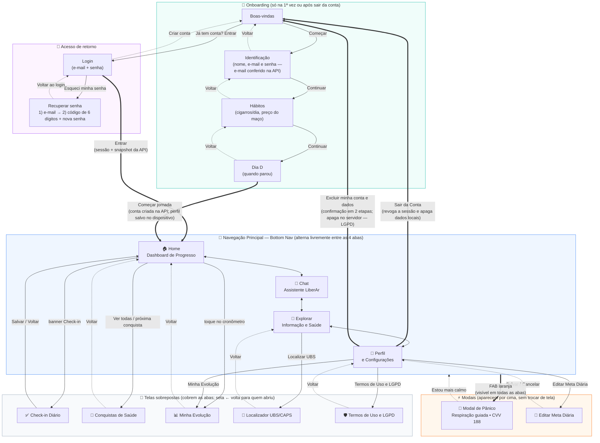

# LiberAr — Fluxo de Navegação

Como as telas se relacionam: o que abre o quê, e para onde cada tela volta.

## Regras de navegação

| Situação | Comportamento |
|---|---|
| Primeira abertura (sem perfil salvo) | O app entra direto no **Onboarding**; as abas só aparecem depois do "Começar jornada" (que cria a conta na API). Quem já tem conta usa "Entrar". |
| Aberturas seguintes | O perfil vem do cache local e o app abre direto na **Home**; com sessão válida, o outbox é reenviado e o snapshot do servidor é puxado em seguida (o servidor vence). |
| Sem conexão | O app continua funcionando com o cache local; as alterações ficam no outbox e o Perfil mostra "Sincronização pendente". Chat e Localizador usam os dados locais e sinalizam o modo offline. |
| Sessão expirada | Se o refresh token for recusado pela API, os dados locais são limpos e o app volta ao início (Onboarding/Login). |
| Recuperar senha | Etapa 1 pede o e-mail (a API responde 202 sempre, sem revelar se existe); etapa 2 pede o código de 6 dígitos recebido por e-mail e a nova senha. |
| Login social | Os botões Google/Apple só ficam ativos com `EXPO_PUBLIC_GOOGLE_CLIENT_ID` / `EXPO_PUBLIC_APPLE_CLIENT_ID`; sem eles, informam que o provedor não está configurado. |
| Abas (Home, Chat, Explorar, Perfil) | Alternam livremente pela bottom nav; nenhuma "volta" — são pares. |
| Telas sobrepostas | Abertas por botões dentro das abas; a seta **←** retorna sempre à tela que as abriu. A bottom nav fica oculta enquanto elas estão abertas. |
| Botão de Emergência (FAB) | Disponível em **qualquer aba**; abre o modal de pânico por cima de tudo, sem perder onde o usuário estava. |
| Sair da Conta | Revoga o refresh token na API, apaga os dados locais e devolve ao início do Onboarding. |
| Excluir minha conta e dados | Confirmação em duas etapas na própria tela; chama `DELETE /me` (direito ao esquecimento — LGPD), apaga os dados locais e volta ao início. |

## Origem de cada tela

| Tela | Origem |
|---|---|
| Home, Chat, Check-in, Explorar, Perfil, Modal de Pânico | **Protótipo do Figma** (mantidas fielmente, apenas conectadas aos dados reais) |
| Onboarding (4 etapas), Conquistas, Evolução, Localizador UBS/CAPS, Termos/LGPD, modal Meta Diária | **Adicionadas** a partir do diagrama de arquitetura (fluxos 1, 4 e 5) |
| Login, Recuperar senha (código), Excluir conta | **Integração com a API** (ver `docs/backend-architecture.md`) |
